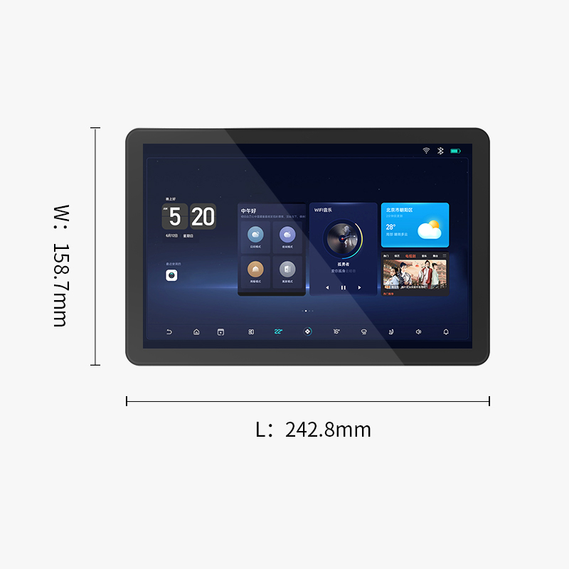
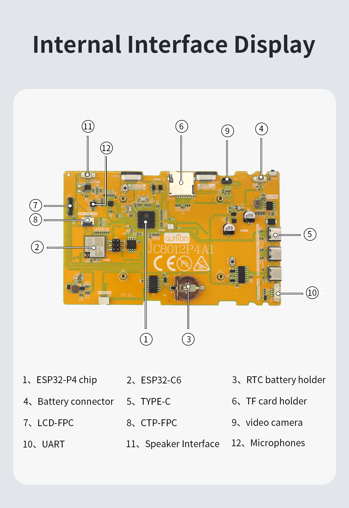
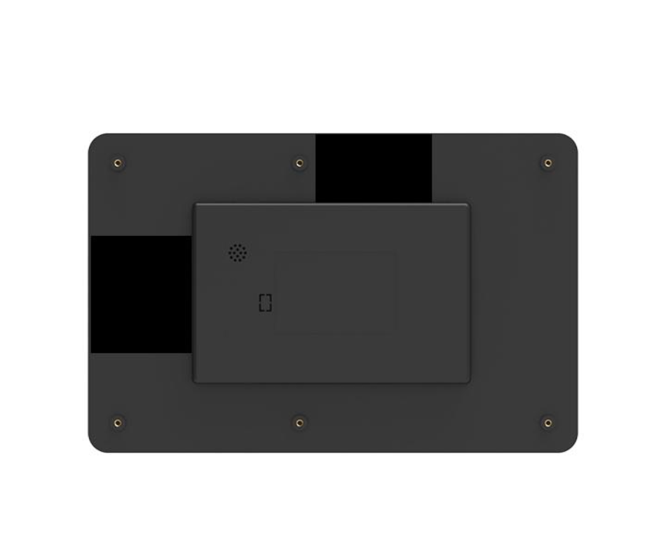

# Guition ESP32-P4 10.1" Display — JC8012P4A1C

ESP32-P4 + ESP32-C6 10.1-inch IPS capacitive touch display module (800 × 1280) with camera, microphone, speaker and battery connector.
จอทัชสกรีน ESP32-P4 ขนาด 10.1 นิ้ว พร้อมกล้อง ไมโครโฟน ลำโพง และขั้วต่อแบตเตอรี่

<table align="center">
  <tr>
    <td align="center"></td>
    <td align="center"></td>
    <td align="center"></td>
  </tr>
  <tr>
    <td align="center">Front &amp; Dimensions</td>
    <td align="center">Internal Interfaces</td>
    <td align="center">Back Cover</td>
  </tr>
</table>

## Specifications / สเปค

| Item | Value |
|---|---|
| Model | JC8012P4A1C_I_W_Y (no battery) / JC8012P4A1C_I_W_Y1 (with battery) |
| MCU | ESP32-P4 RISC-V dual-core, up to 360 MHz |
| Wireless | ESP32-C6 co-processor — Wi-Fi 6 (2.4 GHz), Bluetooth 5 (LE) |
| Memory | 32 MB PSRAM, 16 MB Flash |
| Display | 10.1" IPS, 800 × 1280, 16.7M colors, JD9365 (MIPI-DSI) |
| Touch | Capacitive |
| Camera | MIPI-CSI |
| Audio | ES8311 codec + ES7210 mic ADC, speaker connector |
| Interfaces | USB Type-C, UART, TF card, Li-ion battery connector, RTC battery holder |
| Power | 5 V DC, approx. 700 mA |
| Size / Weight | 242.8 × 158.7 mm, approx. 550 g |

Source: [2-Specification](2-Specification/) · [Guition product page](https://www.guition.com/esp32p4-display-module/10-1-inch-esp32p4-display-module)

## Folder Guide / โครงสร้างโฟลเดอร์

| Folder | Contents / เนื้อหา |
|---|---|
| [1-Demo](1-Demo/) | ESP-IDF (5.5.4, 6.0.2) and Arduino examples — LVGL v8/v9, ESP-Brookesia, video, USB extend screen, Xiaozhi AI |
| [2-Specification](2-Specification/) | Product specification (PDF) |
| [3-Structure_Diagram](3-Structure_Diagram/) | Dimensions, interface layout, CAD (DWG) |
| [4-Driver_IC_Data_Sheet](4-Driver_IC_Data_Sheet/) | ESP32-P4, LCD and camera datasheets |
| [5-Schematic](5-Schematic/) | Schematic (PDF + PNG per block) |
| [6-User_Manual](6-User_Manual/) | Getting Started guide |
| [7-Character&Picture_Molding_Tool](7-Character&Picture_Molding_Tool/) | Font / image conversion tools |
| [8-Burn operation](8-Burn%20operation/) | Factory firmware and Flash Download Tool |

## Quick Start / เริ่มต้นใช้งาน

1. Connect USB Type-C (5 V, 2 A adapter recommended). / ต่อสาย USB Type-C (แนะนำ Adapter 5V 2A)
2. Check your panel version — use **New_Panel** or **Old_Panel** examples to match. / เลือกตัวอย่างให้ตรงรุ่นจอ (New_Panel หรือ Old_Panel)
3. **ESP-IDF:** open an example in `1-Demo/IDF_5.5.4/` and run `idf.py set-target esp32p4 build flash monitor`.
4. **Arduino IDE:** install ESP32 board package v3.1.0 or newer, select **ESP32P4 Dev Module**, then open an example in `1-Demo/arduino-examples/` (see the `.png` setting screenshots in the same folder).
5. **Factory firmware:** flash the files in `8-Burn operation/Burn files` with Flash Download Tool.

> Boards with chip revision v3.x use the examples in `1-Demo/P4V3X_demo/`. / บอร์ดที่ใช้ชิป ESP32-P4 rev v3.x ให้ใช้ตัวอย่างในโฟลเดอร์ P4V3X_demo

---
Distributed in Thailand by **Massmore** — [massmore.shop](https://massmore.shop)
